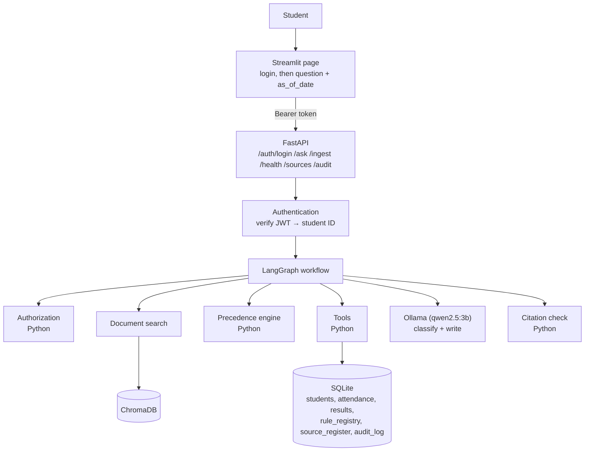
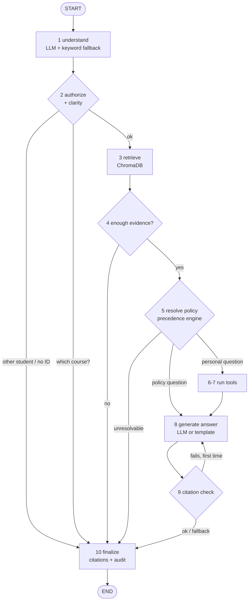

# University Student Services Assistant

An AI assistant that answers student questions **only from authorised university documents and the student's own records**, with a citation for every fact. Built for the HCLTech Future Ready AI Engineer Hackathon.

> **Status:** working MVP, tested locally and in Docker (see [Testing](#testing)).
> **Important:** the documents in `data/documents/` are **synthetic samples** written by the team (all marked `synthetic=Y`). The hackathon guide requires at least 3 real, public university documents (at most 2 synthetic), so replace them before judging. See [Limitations](#limitations).

---

## 1. The problem

University rules are spread across regulations, circulars, notices and FAQs. They change over time, sometimes contradict each other, and apply differently by programme and batch. Students struggle to find the rule that applies **today**, and they can't easily ask personal questions like *"Am I eligible for my exam?"*, because the answer needs their own records combined with the rule.

## 2. What it does

| Feature | How |
|---|---|
| Answers policy questions with citations | Search in ChromaDB → answer from the retrieved text only → citation (document, section, page, version, effective date) |
| Says "not found" instead of guessing | If no passage is similar enough: *"I could not find this information in the authorised university sources."* |
| Picks the officially correct document | Python precedence engine: applicability → supersession → authority → recency → `conflict_flagged` |
| Personal answers (attendance, results, eligibility, placement, what-if) | Deterministic Python tools over SQLite. Thresholds come from the `rule_registry` table, never from code |
| Login + privacy | Students log in with student ID + password (bcrypt). Identity comes **only** from the verified login token (JWT); a student ID sent by the client is never trusted. Other students' data is refused |
| Prompt-injection safety | Document text is data, never instructions. Instruction-like sentences are removed at ingestion; the LLM can't change policy, tools or identity |
| Live ingestion | `POST /ingest` makes a new document usable on the next question, with no restart |
| Audit trail | Every answer has a `trace_id`; `GET /audit/{trace_id}` shows the owner what happened (no names, marks or model reasoning). Logins, logouts and rejected requests go to a security log |

The six answer types: `retrieved_fact`, `calculated`, `not_found`, `clarification_needed`, `refused`, `conflict_flagged`.

## 3. Architecture



**The key design rule: the AI only handles language.** Ollama classifies the question and writes policy answers from the evidence it's given. Plain, tested Python decides **who can see what, which document wins, and every number**.

### LangGraph workflow



| Step | Who | What |
|---|---|---|
| 1 understand | LLM, checked by code | Question type (policy, attendance, results, exam_eligibility, placement_eligibility). Course codes, student IDs and hypothetical numbers are extracted by **regex**, not the LLM |
| 2 authorize | Python | Uses the student ID from the verified token. Personal question with no identity → `refused`. Mentions another student → `refused`. No course → `clarification_needed` |
| 3 retrieve | ChromaDB | Top 12 chunks for the question, plus a search for each rule the question needs |
| 4 evidence | Python | Nothing above similarity 0.40 → `not_found` (no LLM call) |
| 5 policy | Python | Precedence engine picks the governing document/rule; losers listed in `conflicts_detected` |
| 6-7 tools | Python | `get_attendance`, `get_results`, `get_rule`, `check_exam_eligibility`, `check_placement_eligibility` |
| 8 answer | LLM / template | Policy: LLM writes 1-3 sentences labelled `[E1]`. Calculated: fixed template from tool output |
| 9 check | Python | Every label must exist, every number must appear in the cited evidence, no other student ID. Retry once → quote the clause → else `not_found` |
| 10 finalize | Python | Builds citations from chunk metadata (never typed by the LLM), writes the audit record |

### Conflict rules (official Source Precedence Policy)

1. **Applicability:** in force on `as_of_date` and covers the student's programme/batch. Future documents are mentioned as *upcoming*. Level 5 (unofficial) is informational only.
2. **Supersession:** a level 1-2 document that names a document or clause in `supersedes` (e.g. `ACAD-REG-2024#7.2`) replaces it.
3. **Authority:** level 1 (regulations) > 2 (circulars) > 3 (notices) > 4 (FAQs/handbooks).
4. **Recency:** same level → later `effective_from` wins.
5. Still disagreeing → `conflict_flagged`: both sources cited, contact the issuing office.

Example (as of 2026-10-06): Regulation says 75%, a circular supersedes it with 80%, and the FAQ says 65% → **80%**. The regulation lost on supersession and the FAQ lost on authority. With `as_of_date` 2026-07-15 → **75%**, and the circular is shown as an upcoming change.

## 4. Technology

| Part | Technology | Role |
|---|---|---|
| UI | Streamlit | Student page |
| API | FastAPI + Uvicorn + Pydantic v2 | Endpoints and input validation |
| Workflow | LangGraph | The fixed flowchart above |
| Vector search | ChromaDB (persistent) | Finds document chunks by meaning |
| Embeddings | `all-MiniLM-L6-v2` (ONNX, built into Chroma) | Same sentence-transformers model the guide allows, without PyTorch (smaller install and image) |
| LLM | Ollama, `qwen2.5:3b` (configurable) | Classify questions, write policy answers |
| Database | SQLite | Students, courses, attendance, results, rules, document register, audit |
| PDF reading | pypdf | Text with page numbers |
| Packaging / CI | Docker, docker compose, GitHub Actions | |

## 5. Setup and run (local)

Requirements: Python 3.11+, [Ollama](https://ollama.com).

```bash
# 1. Python environment
python3.11 -m venv .venv && source .venv/bin/activate
pip install -r requirements-dev.txt
cp .env.example .env          # then set JWT_SECRET: python -c "import secrets;print(secrets.token_urlsafe(48))"

# 2. Ollama (separate terminal)
ollama serve
ollama pull qwen2.5:3b

# 3. Data: generate/validate synthetic students, ingest documents + rules, load students
python scripts/generate_students.py
python scripts/validate_students.py
python scripts/ingest_documents.py
python scripts/load_students.py --dir data/synthetic

# 4. Run
uvicorn app.main:app --port 8000          # API  -> http://localhost:8000/docs
streamlit run ui/streamlit_app.py         # UI   -> http://localhost:8501
```

Open the UI and **log in**, for example as `S1001` with the demo password `Student@2026` (see [Authentication](#authentication)).

No Ollama? Set `MOCK_LLM=true`. Everything still works: questions are classified by keywords, and policy answers quote the governing clause directly.

## 6. Docker

```bash
ollama serve & ollama pull qwen2.5:3b     # Ollama runs on the host (faster; uses the Mac GPU)
docker compose up --build                 # API :8000, UI :8501
docker compose down                       # stop (data stays in the app_data volume)
docker compose down -v                    # stop and delete the data volume
```

- The API container reaches Ollama at `http://host.docker.internal:11434`. `extra_hosts: host-gateway` makes this work on Linux too. Override with `DOCKER_OLLAMA_BASE_URL=...` (a separate name, so the `localhost` value in `.env` for local runs doesn't leak into the container).
- On first start the container ingests the documents and loads the students. Restarts skip documents that are already ingested (data persists in the `app_data` volume).
- Run without Ollama: `MOCK_LLM=true docker compose up`.

## 7. API

### Authentication

```
Student ID + password ──► POST /auth/login ──► bcrypt check against students.password_hash
                                                   │
                         signed JWT {sub: S1001, exp: +60 min, jti} ◄┘
                                                   │
Authorization: Bearer <JWT> ──► get_current_student() ──► authenticated student ID
                                                   │
                                existing authorization (graph) ──► tools / RAG ──► answer
```

- **Authentication** ("who are you?") happens once, at the API, from the token. **Authorization** ("what may you see?") is unchanged and happens in the LangGraph `authorize` step.
- **Passwords** are stored only as bcrypt hashes (`students.password_hash`), never in plain text, logs or responses.
- **Tokens** are HS256 JWTs signed with `JWT_SECRET` and expire after `JWT_EXPIRE_MINUTES` (default 60). Set `JWT_SECRET` in `.env`; if it is empty, a random secret is used and everyone must log in again after a restart.
- **Logout** (`POST /auth/logout`) revokes the token on the server, so it stops working at once.
- **Why client-supplied IDs are not trusted:** anyone can type `X-Student-Id: S1002`. Only the server can sign a token, and it signs one only after checking the password. The API ignores `X-Student-Id`, rejects a `student_id` field in the body (422) and ignores query parameters. An ID written in the question only ever leads to a refusal.
- **Errors:** wrong password and unknown student get the same `401 Invalid student ID or password.` A missing, invalid, expired or revoked token gets `401 Not authenticated`.
- **Security log:** `login_success`, `login_failure`, `logout` and `unauthorized_request` go to the `security_log` table, without passwords, hashes or tokens.

**Demo accounts:** every seeded student S1001–S1040 has the demo password **`Student@2026`** (set by `DEMO_STUDENT_PASSWORD` when `scripts/load_students.py` runs; demo only). Students loaded later without a password get the same one, or a per-student password from an optional `credentials.csv` (`student_id,password`) next to the CSVs. Useful accounts: S1001 (exactly 80% attendance), S1002 (77.5%), S1008 (what-if placement), S1007 (CGPA at the cut-off).

### Endpoints

Interactive docs: `http://localhost:8000/docs`.

| Method | Path | Login needed | Purpose |
|---|---|---|---|
| POST | `/auth/login` | no | Student ID + password → `access_token` |
| POST | `/auth/logout` | yes | Revoke the current token |
| POST | `/ask` | yes | Ask a question → answer, `answer_type`, citations, tools, rules, conflicts, explanation, `trace_id` |
| GET | `/audit/{trace_id}` | yes | Audit record of one of **your own** answers (others → 404) |
| POST | `/ingest` | no (admin auth is future work) | Upload a document (PDF/TXT/MD) + metadata JSON; usable immediately |
| GET | `/health` | no | Status of API, vector store, SQLite, LLM |
| GET | `/sources` | no | Source Register (all documents and metadata). `/metadata` is an alias |

### curl demo

```bash
# STEP 1 — log in
curl -X POST http://localhost:8000/auth/login -H "Content-Type: application/json" \
  -d '{"student_id":"S1001","password":"Student@2026"}'
# -> {"access_token":"eyJ...","token_type":"bearer","expires_in":3600,"student_id":"S1001"}

# STEP 2 — copy the access_token
TOKEN=eyJ...

# STEP 3 — ask a question
curl -X POST http://localhost:8000/ask -H "Content-Type: application/json" \
  -H "Authorization: Bearer $TOKEN" -d '{"question":"Am I eligible for the CS201 exam?"}'
# -> "Result: Eligible ... Your record: 80% (32 of 40 classes)"   (S1001's record)

# STEP 4 — check identity in the audit record (use the trace_id from step 3)
curl http://localhost:8000/audit/<trace_id> -H "Authorization: Bearer $TOKEN"     # "student_id": "S1001"

# STEP 5 — try to impersonate S1002 with S1001's token
curl -X POST http://localhost:8000/ask -H "Content-Type: application/json" \
  -H "Authorization: Bearer $TOKEN" -H "X-Student-Id: S1002" -d '{"question":"What is my attendance in CS201?"}'
# -> still S1001: "80% (32 of 40 classes attended)", never S1002's 77.5%

# Without a token, or after POST /auth/logout, every /ask returns 401.
```

### Ingestion

```bash
curl -X POST localhost:8000/ingest -F file=@circular.pdf -F 'metadata={
  "doc_id":"ACAD-2026-10","title":"Attendance circular","issuer":"Office of the Dean (Academics)",
  "authority_level":2,"doc_type":"circular","version":"1.0","effective_from":"2026-09-20",
  "supersedes":"ACAD-2026-08#2.1","scope_programmes":"ALL","scope_batches":"ALL","provenance":"https://...",
  "rules":[{"rule_id":"ATT-MIN-03","parameter":"min_attendance_pct","operator":">=","value":"85","source_section":"1.1"}]}'
```

Metadata accepts the guide's field names (`authority_level`, `scope_programmes`, `scope_batches`, `provenance`, …) and the short names `authority`, `program`, `batch`, `source`, `expiry_date`. `rules` is optional: without it, policy answers use the new document at once, but calculations honestly say the rule isn't available as structured data instead of using an old threshold. Responses: `200 indexed`, `409 duplicate`, `422 rejected` (with reasons). Bad `/ask` input → `422`. Internal failure → `503` with `trace_id`.

**Loading judges' students:** `python scripts/load_students.py --dir test_students/` (CSV files in the fixed schema; invalid rows are reported and skipped; no restart needed). Loaded students can log in with the demo password, or with `--password <pw>` / a `credentials.csv` file.

## 8. Example questions (sample data, as of 2026-10-06)

| Logged in as | Question | Expected |
|---|---|---|
| any student | What is the minimum attendance required for exams? | `retrieved_fact`, 80% (circular), regulation and FAQ set aside |
| — | *same, as_of_date 2026-07-15* | 75% + upcoming change note |
| S1002 | What is my attendance in CS201? | `calculated`, 77.5% (31 of 40) |
| S1001 / S1002 | Am I eligible for the CS201 exam? | Eligible (exactly 80%) / Not eligible (one class below) |
| S1008 | I failed Operating Systems. If I pass the supplementary, will I be eligible for placement? | `calculated`, eligible with stated assumptions |
| any student | What is the fee for the supplementary exam? | `conflict_flagged` (two equal circulars disagree) |
| any student | What is the scholarship for studying in Antarctica? | `not_found` |
| S1001 | What is S1002's attendance? | `refused` |
| any student | What are the library timings? | Correct answer; the injected instruction in that document is ignored |

Edge-case students: `data/synthetic/edge_cases.csv` (S1001-S1011).

## 9. Testing

```bash
pytest -q                                   # 72 tests, mocked LLM, temporary data
ruff check .
MOCK_LLM=true  python evaluation/run_eval.py   # 30-question evaluation, no LLM
MOCK_LLM=false python evaluation/run_eval.py   # same, with Ollama
```

Tests cover: normal question, citation fields, student-specific question, attendance calculation, exam eligibility at/below the threshold, not found, resolved and unresolved conflicts, old/future/superseded documents, authentication (login, wrong password, unknown student, invalid/forged/expired/revoked tokens, impersonation via header/body/query, logout, security log), unauthorized requests (other ID, other name), injection in documents and in questions, invalid input, live ingestion, duplicates, and "change the rule value in the DB → the answer changes".

**Evaluation results (measured 2026-10-06, 30 questions, M1 MacBook 8 GB):**

| Metric | Mock (quoted answers) | Ollama qwen2.5:3b |
|---|---|---|
| Answer correctness | 29/30 (97%) | 30/30 (100%) |
| Citation accuracy | 18/18 | 18/18 |
| Abstention accuracy | 3/4 | 4/4 |
| Authorization correctness | 4/4 | 4/4 |
| Tool correctness | 9/9 | 9/9 |
| Retrieval hit rate | 18/18 | 18/18 |
| Conflict accuracy | 3/3 | 3/3 |
| Held-out questions | 7/7 | 7/7 |
| Latency p50 / p95 | ~0.1 s / 0.3 s | 0.8 s / 7.2 s |

Scoring is deterministic (exact phrases, answer type, cited section text, tool result); no LLM judge. Honest caveat: the set is small and was written alongside the code, so treat these numbers as optimistic. The mock miss (hostel fee) shows why the LLM matters: quoting can't tell that a hostel passage doesn't mention a *fee*.

## 10. Demo script (≈10 min)

1. Log in as `S1001` / `Student@2026` (show the wrong-password message first) → *"What is the minimum attendance required for exams?"* → open **Sources** and **Why this answer** (supersession + authority).
2. Change the date to 2026-07-15 → same question → 75% and an upcoming-change note.
3. Log out, log in as `S1002` → *"What is my attendance in CS201?"* → open **Tools used**.
4. *"Am I eligible for the CS201 exam?"* as S1002 (not eligible), then log in as S1001 (eligible, exactly at the limit).
5. *"What is the fee for the supplementary exam?"* → `conflict_flagged`.
6. *"What is the scholarship for studying in Antarctica?"* → `not_found`.
7. `S1001` → *"What is S1002's attendance?"* → `refused`. Then *"What are the library timings?"* → injection ignored.
8. Bonus: the curl impersonation demo (section 7), open `/audit/<trace_id>`, and ingest a new circular with `curl` → ask again.

Before judging: run `ollama serve`, ask one warm-up question (the first call loads the model, ~10 s), and keep `MOCK_LLM=true` as a backup.

## 11. Project structure

```
app/
  api/routes.py          endpoints
  graph/                 LangGraph state, nodes, workflow (+ audit)
  retrieval/             loaders, chunker, ChromaDB store, ingestion pipeline
  policy/                precedence engine (pure), topic map, resolver
  tools/student_tools.py the 5 deterministic tools
  security/              injection cleaning, citation checker
  services/              question understanding, answer templates, data validation
  llm/                   Ollama client, prompts
  db/                    SQLite schema and queries
  models/schemas.py      Pydantic request/response models
  config.py              settings from .env
data/
  documents/             sample PDFs (+ source_text/ used to generate them)
  source_register.csv    document metadata
  rules.csv              rule_registry rows, each linked to a clause
  synthetic/             student CSVs, edge cases, validation report
scripts/                 ingest_documents, generate/validate/load_students, make_sample_pdfs, start_api.sh
evaluation/              questions.jsonl, run_eval.py, reports/
tests/                   pytest suite
ui/streamlit_app.py
docs/                    design documents, data card
```

## 12. Limitations

- **Sample documents are synthetic.** Replace at least 3 with real public documents from our university, update `data/source_register.csv` and `data/rules.csv`, then re-run ingestion. Keep at most 2 synthetic ones (the mock circular and the injection test).
- Synthetic students come from a seeded Python generator, not an LLM. The guide scores "AI-assisted generation discipline"; add an LLM-assisted generation step with saved prompts if time allows.
- Text conflicts between documents **without** a rule in `rule_registry` are detected by comparing percentages and Rs. amounts in the best-matching passages. This is a heuristic; rule-based conflicts are exact.
- CGPA is not recalculated in what-if questions (the fixed schema has no grade points); the answer says so.
- No OCR: scanned PDFs are rejected with a clear error. Only PDF, TXT and MD are supported.
- English only. One conversation turn (no chat memory).
- `/ingest` has no admin login (fine for the hackathon). Students only: there are no staff/admin accounts, password reset or rate limiting on login.
- All seeded students share one documented demo password; a real deployment would issue individual passwords.
- Mock mode can't tell when a passage is on-topic but doesn't contain the requested fact (the LLM handles this).
- The GitHub Actions workflow has not been run yet (no remote repository at the time of writing). Every command in it was run locally.

## 13. Future improvements

OCR for scanned documents · hybrid keyword + vector search · an LLM-assisted helper that proposes `rule_registry` rows from a newly ingested circular for human approval · a comparison of two embedding models in the evaluation · chat memory · admin accounts and login for `/ingest`, login rate limiting, password change/reset.
